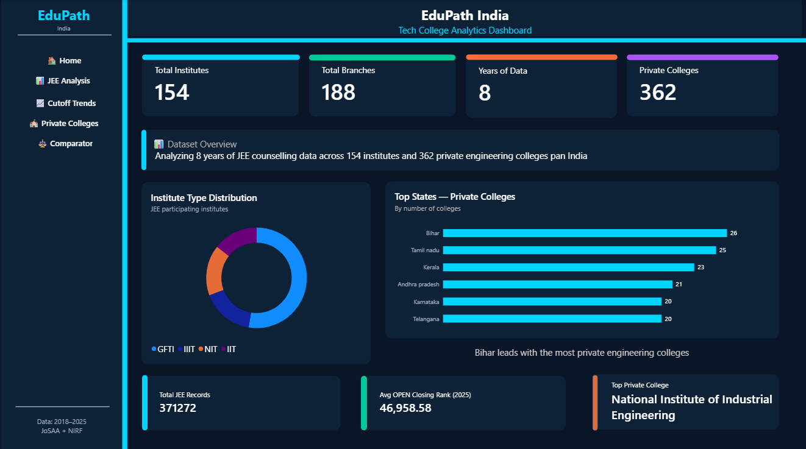
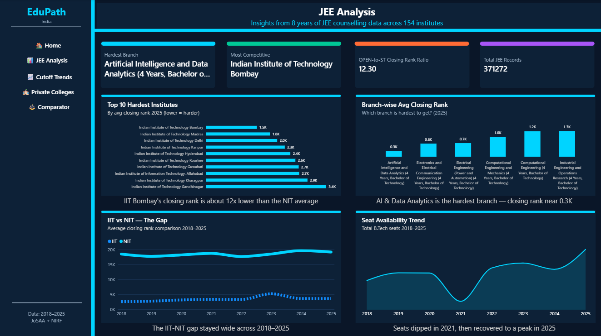
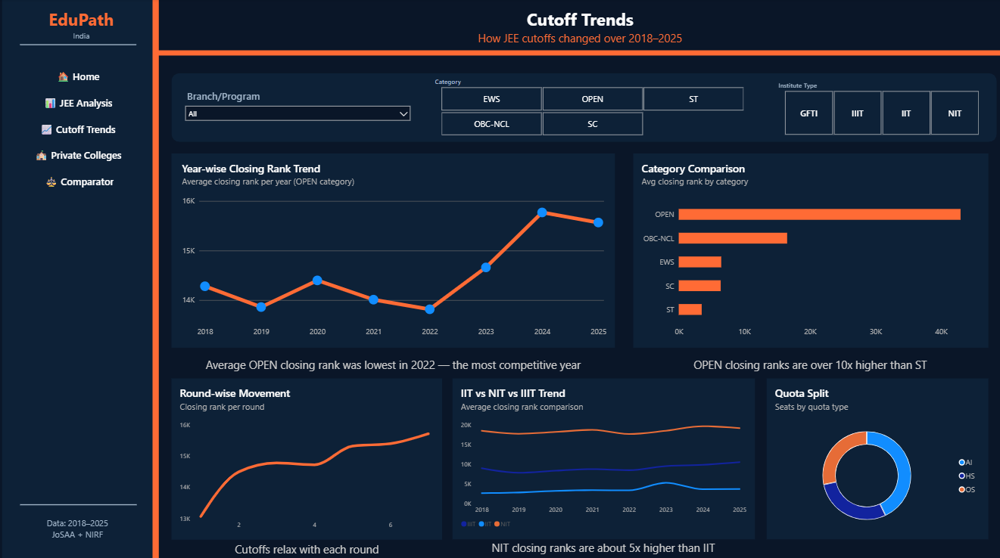
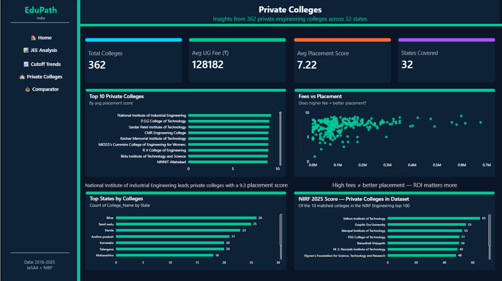
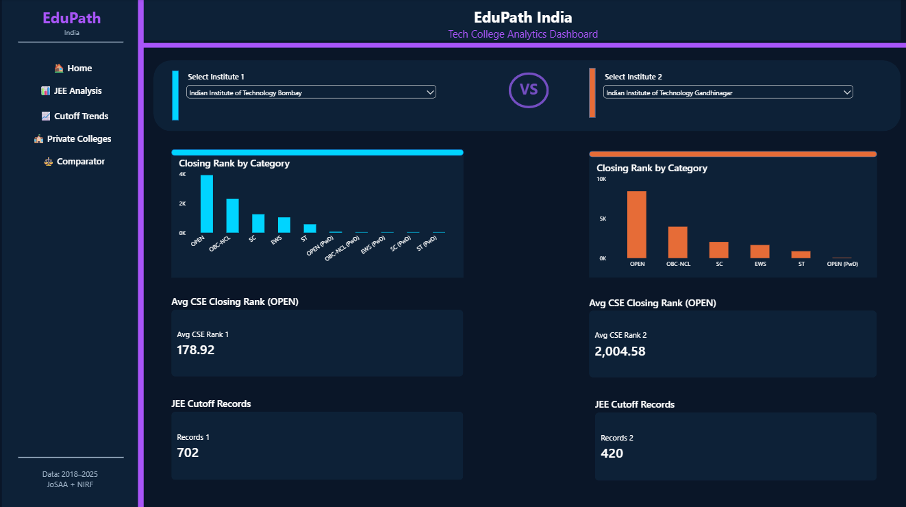

# EduPath India — Engineering College Analytics Dashboard

An interactive Power BI dashboard that analyses 8 years (2018–2025) of JEE counselling (JoSAA) cutoffs and private engineering college data, to help students compare institutes, branches and categories.

## Dashboard Pages

| Page | What it shows |
|------|---------------|
| Home | Key totals: 154 institutes, 188 B.Tech programs, 362 private colleges |
| JEE Analysis | Hardest institutes and branches, IIT vs NIT gap, seat availability trend |
| Cutoff Trends | Year-wise, round-wise and category-wise closing ranks, with slicers for branch, category and institute type |
| Private Colleges | Top colleges by placement score, fees vs placement, state-wise distribution |
| Comparator | Side-by-side comparison of any two institutes (OPEN category, CSE) |

## Screenshots

## Key Insights

- AI & Data Analytics is the hardest B.Tech branch to get into (average closing rank near 0.3K).
- IIT Bombay's average closing rank is about 12x lower than the NIT average; the IIT–NIT gap stayed wide across 2018–2025.
- OPEN-category closing ranks are over 10x higher than ST.
- Total B.Tech seats dipped in 2021, then recovered to a peak in 2025.
- Among private colleges, higher fees do not guarantee better placement scores.

## Data Preparation

- JEE data: JoSAA opening and closing ranks for 2018–2025, merged from yearly files into one dataset (about 4.3 lakh rows).
- Private colleges data: public Kaggle dataset of Indian engineering colleges with fees, overall rating and category scores (academic, faculty, infrastructure,      placement and so on). The placement score is a rating out of 10, not a placement percentage or salary.
- Analysis limited to B.Tech programs (370K+ cutoff records).
- Removed non-engineering institutes and colleges with missing placement data from the private college set (362 colleges remain).
- Comparator uses the 4-year Computer Science and Engineering program, OPEN seat type.

## Tools

Power BI, DAX, Power Query, Python, MySQL

## Files

- `edupath_final.pbix` — the Power BI report
- `EduPath_India_Dashboard.pdf` — PDF export of all pages
- `01_data_cleaning.ipynb` — Python notebook for data cleaning and preparation
- `analysis_queries.sql` — SQL queries used for analysis

## How to View

Download `edupath_final.pbix` and open it in Power BI Desktop (free for Windows), or see the PDF export and screenshots above.

## Author

Harshita Bansal — B.Tech CSE, Lovely Professional University
LinkedIn: https://www.linkedin.com/in/harshita-bansal-084286321/?isSelfProfile=true
